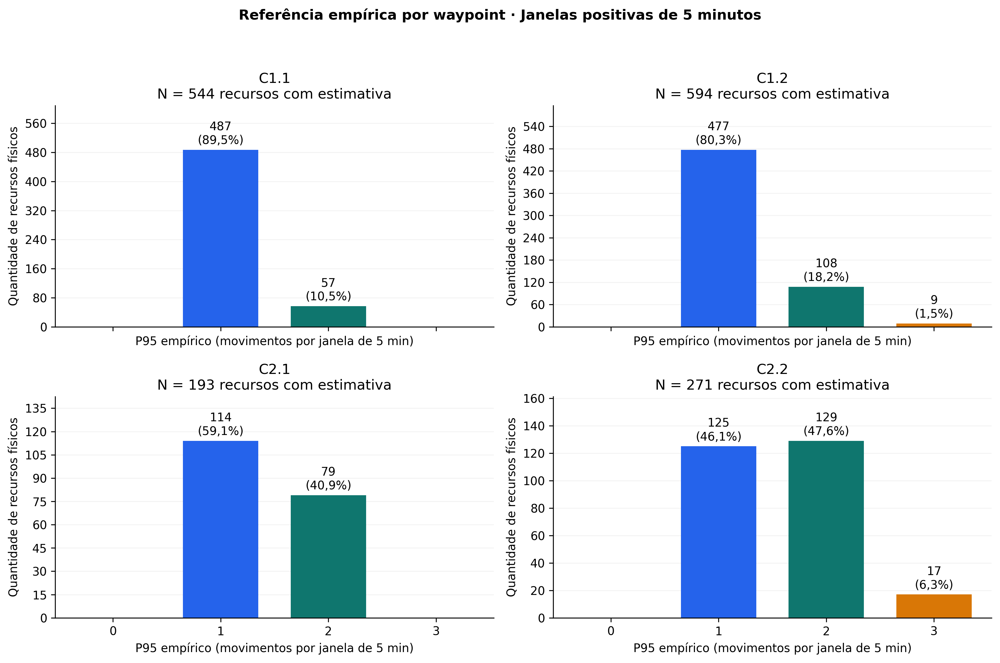
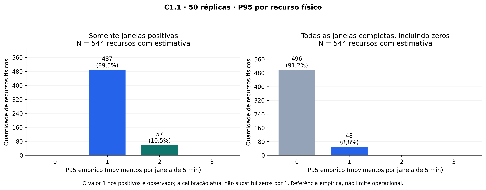
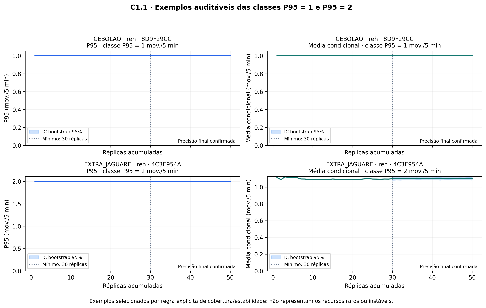
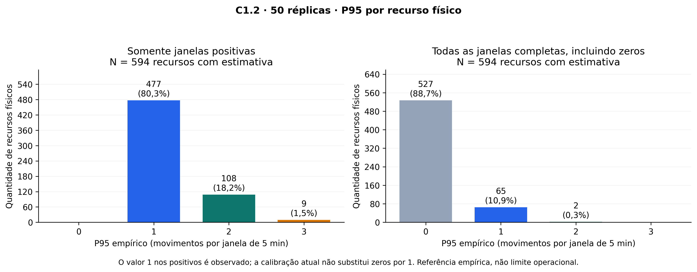
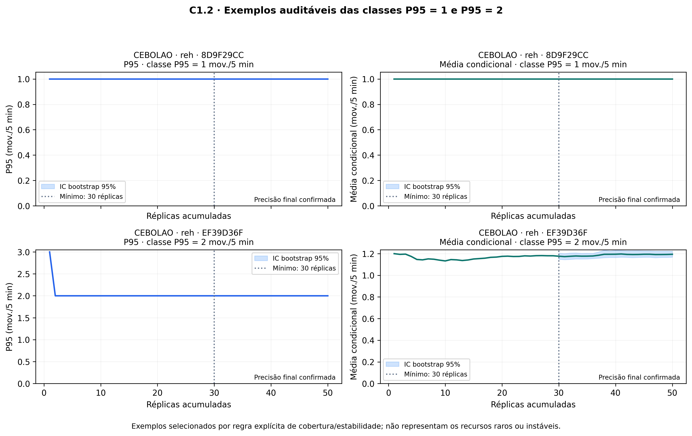
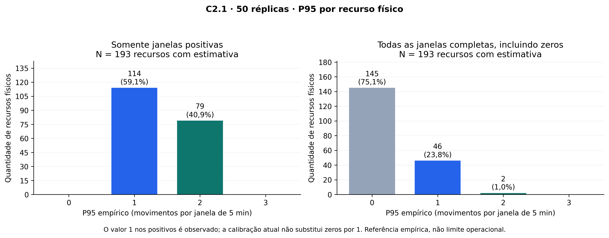
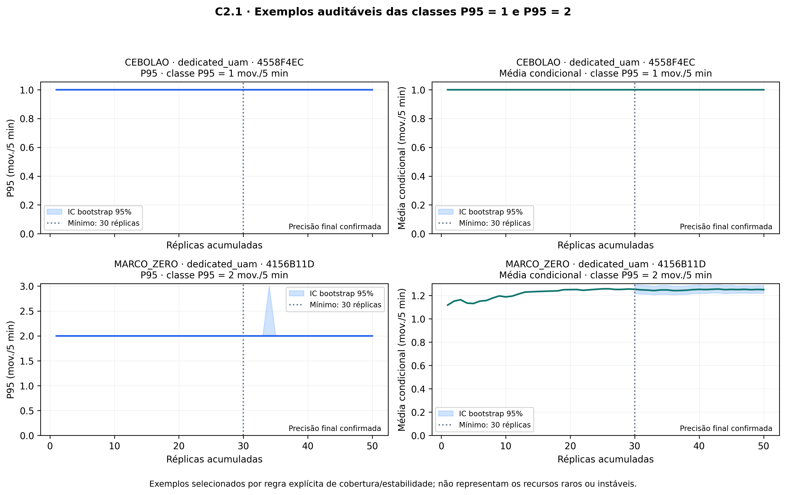
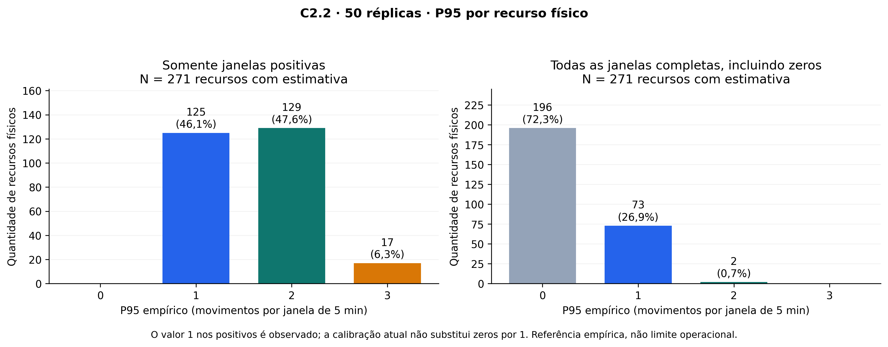
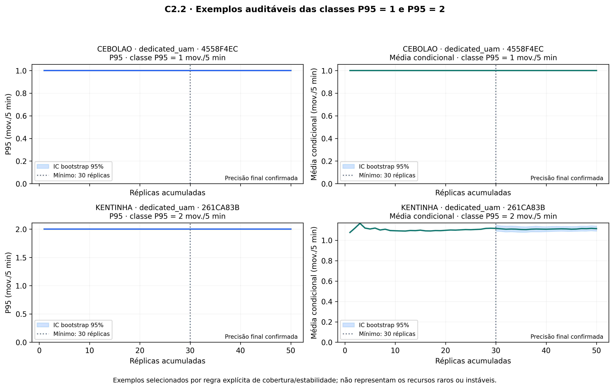

# Evidências para o relatório: referência de 1 ou 2 movimentos por waypoint

**Pacote histórico da rodada de 15/10.** A conclusão vigente sobre o parâmetro do DCB por waypoint está no [registro da recalibração de 27/10](../baseline_capacity_2026-10-29/CONCLUSAO.md): mantêm-se 2 movimentos por recurso físico/300 s. As figuras e contagens abaixo foram preservadas como histórico; não devem ser apresentadas como resultados da rodada nova. Links abaixo que apontam para `docs/assets/data/baseline_calibration/` referenciam uma pasta atualizável: confira a proveniência e os hashes do snapshot antes de usá-los para reproduzir este relatório histórico.

Snapshot de 20/10/2026. Dados reais do commit `f30f4de940b138d3c8ab97029c159fa74999a740`, obtidos de 50 réplicas nativas de cada baseline. Gráficos derivados dos resultados publicados, sem reprocessar logs nem alterar a calibração. O [histórico completo e contexto para outras LLMs](../../ITERATION_LOG.md) registra as decisões, comandos e incidentes.

## Resultado principal e ressalva sobre o fallback

**1576/1602 recursos físicos (98,4%) apresentam P95 positivo de 1 ou 2 movimentos por janela de 5 min.** Essa é uma proporção de recursos, não de movimentos. Há recursos com P95 igual a 3, que não devem ser arredondados para 2 para adequar uma narrativa.

O cálculo atual não tem piso 1. Ele remove os zeros somente na política positiva, calcula P95 `higher` e retorna indisponível para recurso sem uso. A regra histórica no outro repositório devolvia `minimum=1` na ausência de janelas positivas. Como todos os recursos atuais têm janelas positivas, o valor 1 mostrado aqui é observado; não é uma imputação por fallback. O condicionamento em janelas positivas também implica que qualquer percentil definido será pelo menos 1.

| Cenário | Recursos físicos | P95 = 1 | P95 = 2 | P95 > 2 | Fração com 1 ou 2 | P95 estável no critério |
|---|---:|---:|---:|---:|---:|---:|
| C1.1 | 544 | 487 | 57 | 0 | 100,0% | 215 |
| C1.2 | 594 | 477 | 108 | 9 | 98,5% | 236 |
| C2.1 | 193 | 114 | 79 | 0 | 100,0% | 127 |
| C2.2 | 271 | 125 | 129 | 17 | 93,7% | 167 |



[Figura vetorial de comparação](figures/00_comparacao_quatro_baselines_5min.svg). `scenario_summary.csv` também registra os resultados com zeros, a estabilidade da média e a cobertura.

## Critério de seleção dos exemplos

P95 positivo = 1 ou 2; estabilidade final confirmada; >=100 janelas positivas; contagem mais próxima da mediana da classe; desempate pelo ID físico. A mediana considera toda a classe, antes dos filtros. Em C1.1/C1.2 a mediana de cobertura da classe 1 é baixa; o piso de 100 seleciona intencionalmente exemplos com mais evidência, não uma amostra representativa dos recursos raros. As distribuições usam **todos** os recursos, sem filtro por estabilidade. `selected_waypoints.csv` explicita os candidatos e as medianas.

Os PNGs novos têm 300 dpi; os SVGs preservam os elementos vetoriais e textos. Os gráficos originais permanecem em `docs/assets/data/baseline_calibration/`. As tabelas detalhadas para o relatório estão em `waypoint_capacity_evidence.csv` (um registro por recurso/cenário) e `network_summary.csv` (REH/UAM separados).

## C1.1



**Legenda sugerida:** Distribuição do P95 de passagens por recurso físico no cenário C1.1, reunindo 50 réplicas. À esquerda, somente janelas positivas; à direita, todas as janelas completas de 300 s. A diferença decorre da inclusão da ociosidade, sem substituição de zeros por um. O eixo horizontal está em movimentos por janela, não em operações/h. [Versão vetorial](figures/C1_1_distribuicao_5min.svg).



**Legenda sugerida:** Evolução acumulada do P95 e da média condicional para dois recursos físicos de C1.1, selecionados por regra explícita de cobertura e estabilidade. As faixas mostram IC95% por reamostragem de réplicas inteiras. Esses exemplos ilustram referências de um e dois movimentos por 5 min; não comprovam capacidade operacional máxima. [Versão vetorial](figures/C1_1_exemplos_1_2.svg).

- Classe 1: **CEBOLAO**, rede `reh`, ID `R08ECDCB9191F8D9F29CC`, altitude 3000.0 ft; 100 janelas positivas. IC95% final do P95: [1.0; 1.0] movimentos/5 min.
- Classe 2: **EXTRA_JAGUARE**, rede `reh`, ID `R1531934480AC4C3E954A`, altitude 3000.0 ft; 1431 janelas positivas. IC95% final do P95: [2.0; 2.0] movimentos/5 min.

**Sensibilidade à janela:** [histogramas originais de 5/15/60 min](../../docs/assets/data/baseline_calibration/C1.1_positive_histogram.png) e [distribuições acumuladas originais](../../docs/assets/data/baseline_calibration/C1.1_positive_cdf.png). Nos originais, o eixo horizontal é operações/h: 12 e 24 correspondem a 1 e 2 movimentos por 5 min.

## C1.2



**Legenda sugerida:** Distribuição do P95 de passagens por recurso físico no cenário C1.2, reunindo 50 réplicas. À esquerda, somente janelas positivas; à direita, todas as janelas completas de 300 s. A diferença decorre da inclusão da ociosidade, sem substituição de zeros por um. O eixo horizontal está em movimentos por janela, não em operações/h. [Versão vetorial](figures/C1_2_distribuicao_5min.svg).



**Legenda sugerida:** Evolução acumulada do P95 e da média condicional para dois recursos físicos de C1.2, selecionados por regra explícita de cobertura e estabilidade. As faixas mostram IC95% por reamostragem de réplicas inteiras. Esses exemplos ilustram referências de um e dois movimentos por 5 min; não comprovam capacidade operacional máxima. [Versão vetorial](figures/C1_2_exemplos_1_2.svg).

- Classe 1: **CEBOLAO**, rede `reh`, ID `R08ECDCB9191F8D9F29CC`, altitude 3000.0 ft; 100 janelas positivas. IC95% final do P95: [1.0; 1.0] movimentos/5 min.
- Classe 2: **CEBOLAO**, rede `reh`, ID `R2EE3A51AD4E9EF39D36F`, altitude 3000.0 ft; 736 janelas positivas. IC95% final do P95: [2.0; 2.0] movimentos/5 min.

**Sensibilidade à janela:** [histogramas originais de 5/15/60 min](../../docs/assets/data/baseline_calibration/C1.2_positive_histogram.png) e [distribuições acumuladas originais](../../docs/assets/data/baseline_calibration/C1.2_positive_cdf.png). Nos originais, o eixo horizontal é operações/h: 12 e 24 correspondem a 1 e 2 movimentos por 5 min.

## C2.1



**Legenda sugerida:** Distribuição do P95 de passagens por recurso físico no cenário C2.1, reunindo 50 réplicas. À esquerda, somente janelas positivas; à direita, todas as janelas completas de 300 s. A diferença decorre da inclusão da ociosidade, sem substituição de zeros por um. O eixo horizontal está em movimentos por janela, não em operações/h. [Versão vetorial](figures/C2_1_distribuicao_5min.svg).



**Legenda sugerida:** Evolução acumulada do P95 e da média condicional para dois recursos físicos de C2.1, selecionados por regra explícita de cobertura e estabilidade. As faixas mostram IC95% por reamostragem de réplicas inteiras. Esses exemplos ilustram referências de um e dois movimentos por 5 min; não comprovam capacidade operacional máxima. [Versão vetorial](figures/C2_1_exemplos_1_2.svg).

- Classe 1: **CEBOLAO**, rede `dedicated_uam`, ID `R32C7A9B1DFAB4558F4EC`, altitude 3999.34 ft; 100 janelas positivas. IC95% final do P95: [1.0; 1.0] movimentos/5 min.
- Classe 2: **MARCO_ZERO**, rede `dedicated_uam`, ID `R07CE6E2669CE4156B11D`, altitude 3999.34 ft; 760 janelas positivas. IC95% final do P95: [2.0; 2.0] movimentos/5 min.

**Sensibilidade à janela:** [histogramas originais de 5/15/60 min](../../docs/assets/data/baseline_calibration/C2.1_positive_histogram.png) e [distribuições acumuladas originais](../../docs/assets/data/baseline_calibration/C2.1_positive_cdf.png). Nos originais, o eixo horizontal é operações/h: 12 e 24 correspondem a 1 e 2 movimentos por 5 min.

## C2.2



**Legenda sugerida:** Distribuição do P95 de passagens por recurso físico no cenário C2.2, reunindo 50 réplicas. À esquerda, somente janelas positivas; à direita, todas as janelas completas de 300 s. A diferença decorre da inclusão da ociosidade, sem substituição de zeros por um. O eixo horizontal está em movimentos por janela, não em operações/h. [Versão vetorial](figures/C2_2_distribuicao_5min.svg).



**Legenda sugerida:** Evolução acumulada do P95 e da média condicional para dois recursos físicos de C2.2, selecionados por regra explícita de cobertura e estabilidade. As faixas mostram IC95% por reamostragem de réplicas inteiras. Esses exemplos ilustram referências de um e dois movimentos por 5 min; não comprovam capacidade operacional máxima. [Versão vetorial](figures/C2_2_exemplos_1_2.svg).

- Classe 1: **CEBOLAO**, rede `dedicated_uam`, ID `R32C7A9B1DFAB4558F4EC`, altitude 3999.34 ft; 100 janelas positivas. IC95% final do P95: [1.0; 1.0] movimentos/5 min.
- Classe 2: **KENTINHA**, rede `dedicated_uam`, ID `RB246537861C2261CA83B`, altitude 3999.34 ft; 628 janelas positivas. IC95% final do P95: [2.0; 2.0] movimentos/5 min.

**Sensibilidade à janela:** [histogramas originais de 5/15/60 min](../../docs/assets/data/baseline_calibration/C2.2_positive_histogram.png) e [distribuições acumuladas originais](../../docs/assets/data/baseline_calibration/C2.2_positive_cdf.png). Nos originais, o eixo horizontal é operações/h: 12 e 24 correspondem a 1 e 2 movimentos por 5 min.

## Texto-base tecnicamente sustentado

“Adotou-se o P95 do fluxo observado em janelas positivas de 300 s como referência empírica para parametrização dos recursos físicos. A predominância de referências de um ou dois movimentos por janela fundamenta a análise de parâmetros individualizados por waypoint, em lugar de um valor uniforme. A escolha é condicionada à demanda dos baselines, ao cenário e ao tratamento da ociosidade; não constitui comprovação de capacidade operacional máxima ou de segurança. Recursos com referência superior a dois ou precisão não confirmada são tratados separadamente.”

## Antes de fixar a capacidade operacional

- Não confundir P95 de demanda atendida, capacidade configurada e capacidade máxima demonstrada. A ausência de movimento não comprova capacidade zero.
- Não atribuir um mesmo limite a todas as posições que compartilham um nome. Use ID físico, rede, coordenadas e altitude.
- Examinar os casos P95 > 2 e a estabilidade de cada recurso, não apenas os oito exemplos selecionados.
- Verificar a sensibilidade ao estágio de demanda em `stage_sensitivity.csv`. O mesmo recurso físico pode mudar de classe entre 6 e 12 vertiportos; a referência observada não é uma propriedade intrínseca imutável do waypoint.
- Não somar referências de waypoints para calcular capacidade da rede; um voo pode atravessar vários recursos.
- Não interpretar IC bootstrap degenerado ou P95 incondicional zero como prova de suficiência/segurança. Há muitos recursos raros e janelas ociosas.
- Mudanças nos limites dos algoritmos exigem validação posterior de atrasos, conflitos e ocupação. Este pacote não altera parâmetros de simulação.

## Reprodução e integridade

```bash
.venv/bin/python scripts/build_baseline_capacity_evidence.py
```

`evidence_manifest.json` registra SHA-256 dos dados e das figuras selecionadas. O script confere o CSV contra o JSON, usa os intervalos de confiança já calculados e faz apenas conversões de unidade. Ao regenerar sobre outros dados, reavalie as conclusões históricas deste snapshot e preserve a versão anterior para rastreabilidade.
