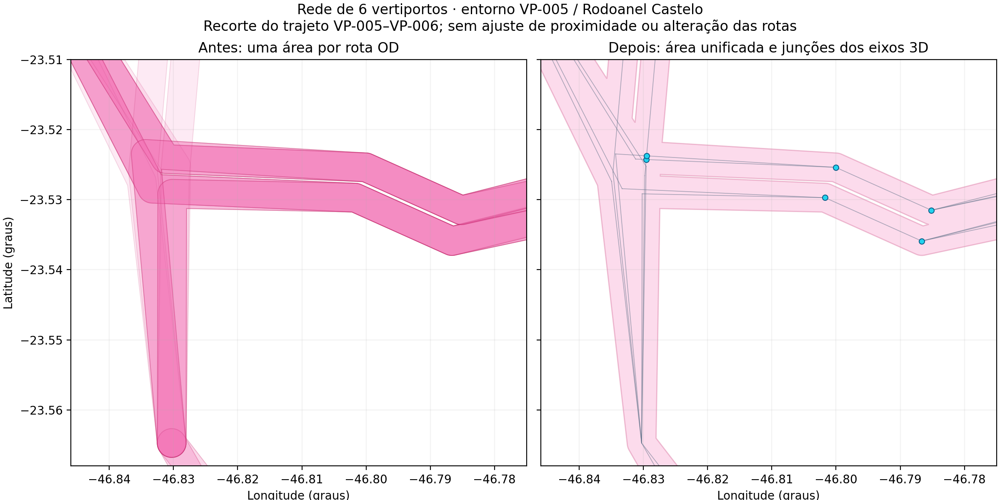
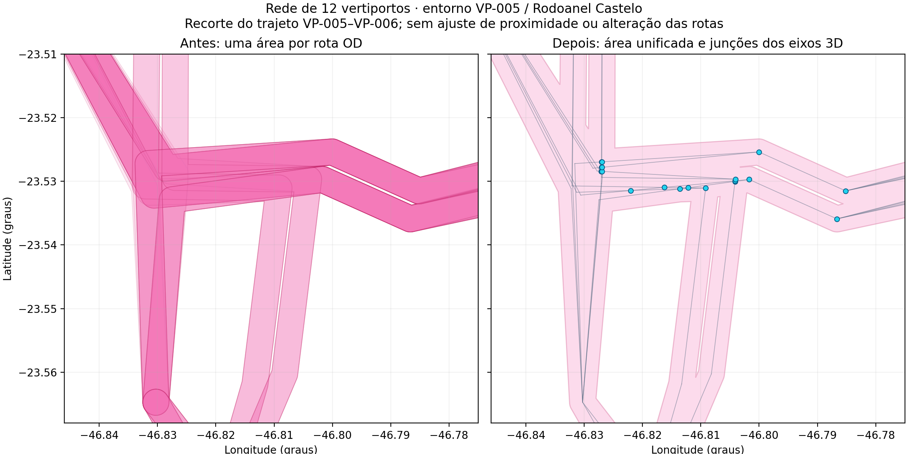

# Auditoria da união dos corredores UAM — 21/10/2026

O acúmulo de corredores no trecho VP-005–VP-006 decorre, em parte, de desenhar uma área para cada rota origem–destino: muitos trajetos reutilizam segmentos físicos. A união dessas áreas evita a sobreposição de preenchimentos e bordas. **Uma sobreposição horizontal não comprova uma junção 3D**: pistas paralelas e níveis distintos precisam continuar separados.

| Rede | Rotas OD/pista | Ocorrências de segmentos | Segmentos únicos antes da divisão | Repetições eliminadas | Segmentos após divisão nas interseções | Junções geométricas não terminais |
|---|---:|---:|---:|---:|---:|---:|
| 6 vertiportos | 72 | 858 | 222 | 636 | 280 | 72 |
| 12 vertiportos | 210 | 2.156 | 412 | 1.744 | 642 | 199 |

Contagens da rede inteira, conforme [summary.json](summary.json). “Junção” aqui significa grau de pelo menos três no grafo dos eixos, sem afirmar elegibilidade para capacidade. A contagem de verificações de interseção separadas no JSON é de verificações entre pares, não de locais únicos.

## Comparação do recorte indicado

Rede de 6 vertiportos:



Rede de 12 vertiportos, usando o CSV validado correspondente aos cenários `.2`:



O recorte cobre VP-005 e Rodoanel Castelo no trajeto VP-005–VP-006. Rosa: projeção horizontal dos corredores. À direita, linhas finas representam os eixos físicos sem repetições; pontos cianos representam junções geométricas. Os vazios internos dos polígonos foram preservados. As figuras não são uma alteração da malha de entrada da simulação.

## Regras e limites

- As áreas são unidas a partir dos buffers métricos existentes, incluindo seus vazios internos. Nenhuma área coberta é descartada; a união é somente da projeção para o mapa.
- Segmentos coincidentes, inclusive percorridos em sentidos opostos, compartilham uma aresta. Sobreposições parciais são divididas nos extremos e interseções.
- Conectividade exige interseção dos eixos e igualdade da altitude interpolada com precisão numérica de 1 mm, além das mesmas dimensões. Coordenadas horizontais do grafo usam oito casas decimais, aproximadamente 1 mm. Não há aproximação de pistas próximas nem fusão por nome de waypoint.
- Entroncamentos geométricos e cruzamentos no mesmo nível entram no diagnóstico. O grafo é não direcionado: não define permissões de conversão, separações ou procedimentos de voo.
- Terminais explícitos são excluídos da camada de junções. Pontos sem nome podem aparecer no diagnóstico; não viram recursos de capacidade.
- A seleção analítica de waypoints nomeados, as capacidades já calibradas, os recursos nativos WPPASS e o método REH não foram alterados. As novas junções geométricas têm `capacity_resource: false`.
- Alterar efetivamente a malha da simulação exigiria atualizar o gerador e seus manifests e avaliar novas simulações. Este pós-processamento permite analisar os logs existentes sem lhes atribuir uma malha operacional diferente.

## Fontes e reprodução

[network_stage_1.json](network_stage_1.json) e [network_stage_2.json](network_stage_2.json) contêm os eixos consolidados com proveniência por rota, polígonos e junções. Os GeoJSONs `local_junctions_stage_*.geojson` permitem inspecionar os pontos do recorte. Os hashes dos CSVs estão no resumo e nos arquivos completos.

O CSV validado de 12 vertiportos foi copiado do repositório de simulação, sem alterá-lo. Dois SCNs reais originais, réplica 001 de C2.1 e C2.2, também foram conferidos contra seus CSVs: 1.732 e 4.113 posições internas, com desvios máximos de 0,057 m e 0,065 m, respectivamente. Veja [scn_validation.json](scn_validation.json). Essa conferência é horizontal; não valida altitudes da simulação.

```powershell
.venv/Scripts/python.exe scripts/build_uam_geometry_audit.py
```

O script refaz as figuras e os dados de geometria a partir dos CSVs versionados, sem precisar dos STATELOGs. A conferência dos SCNs está registrada separadamente, pois suas fontes pertencem ao repositório de simulação.
